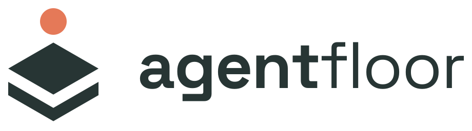
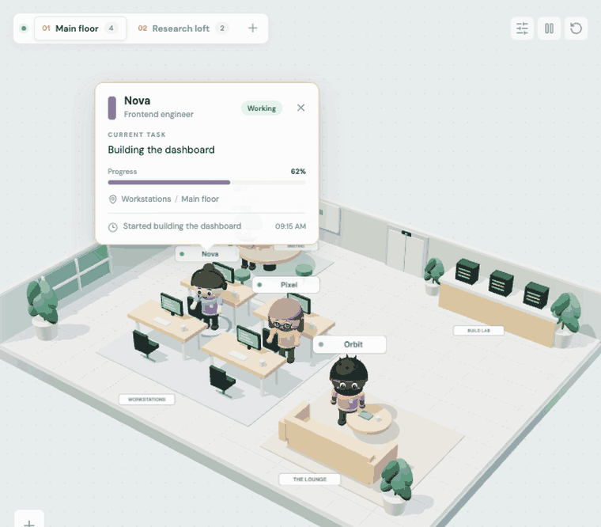
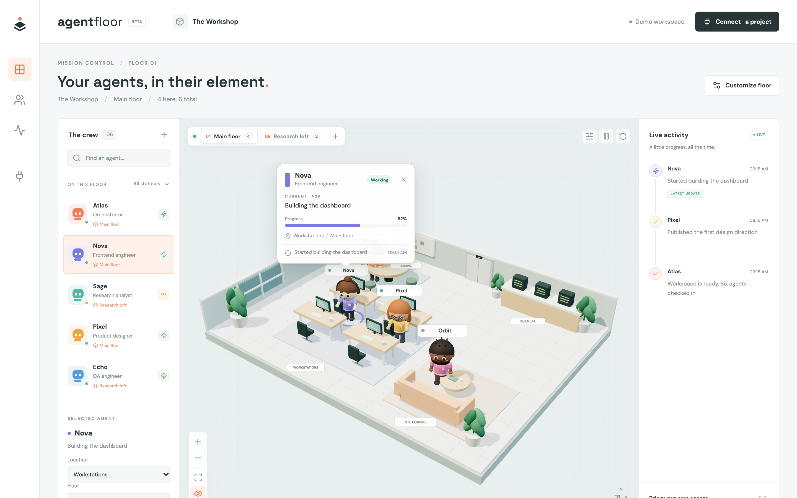
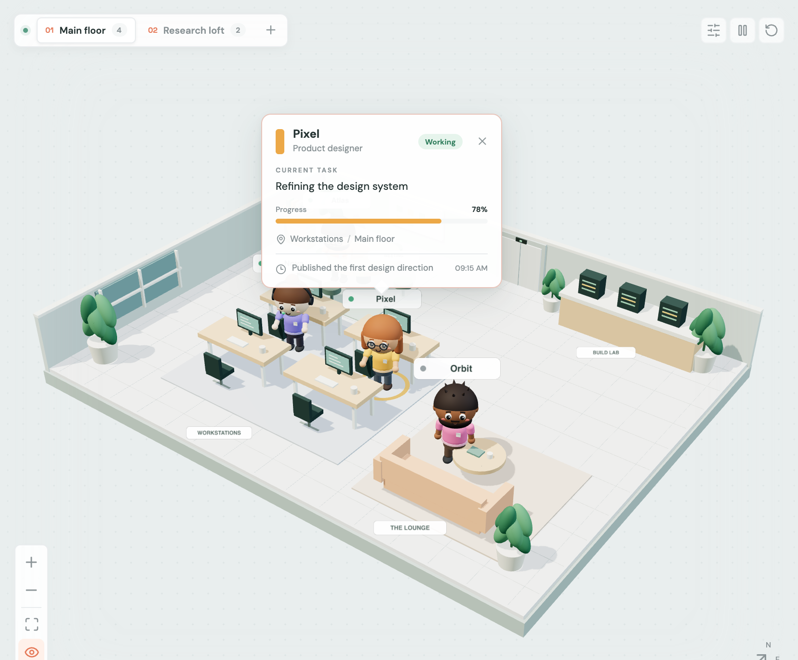
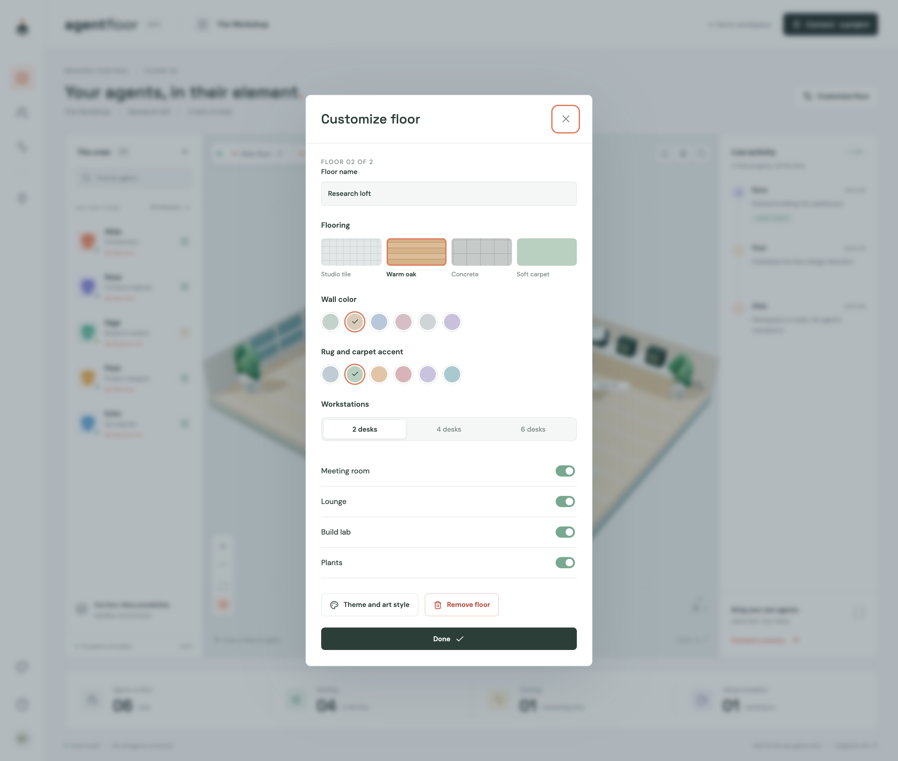
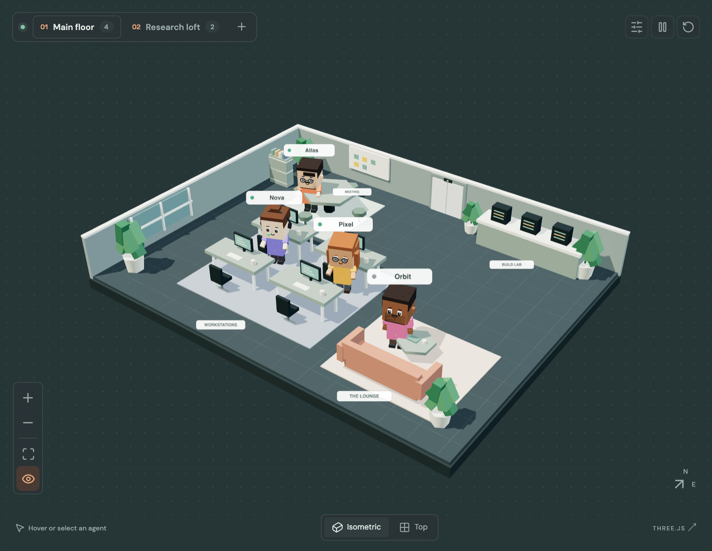
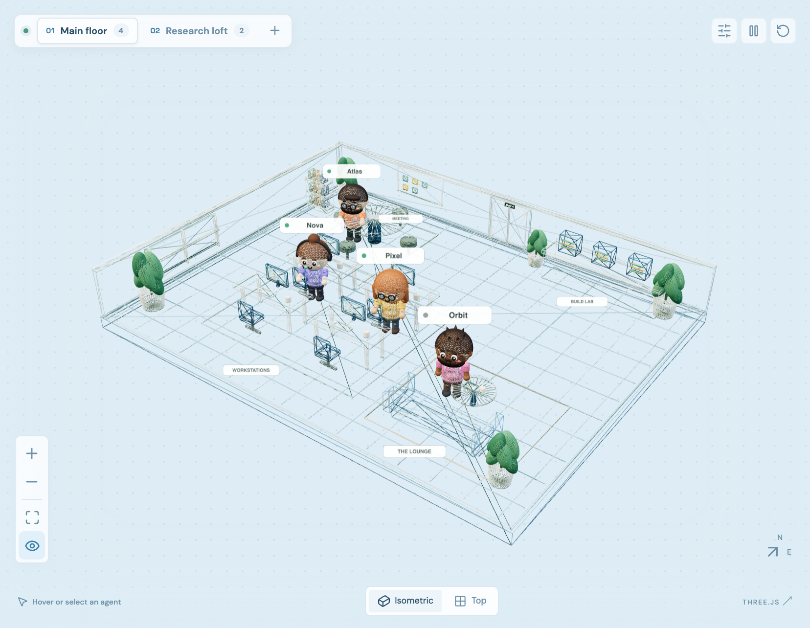
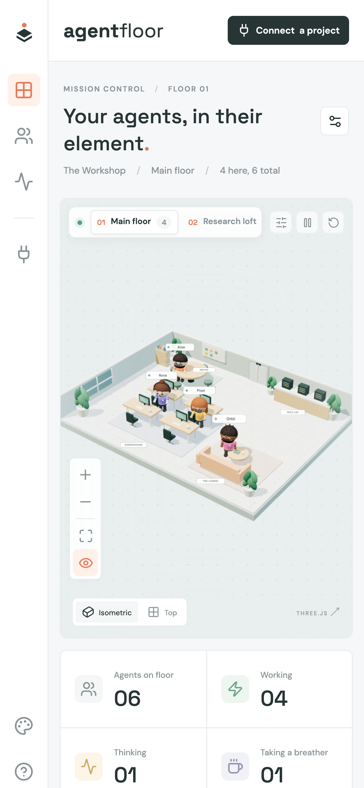
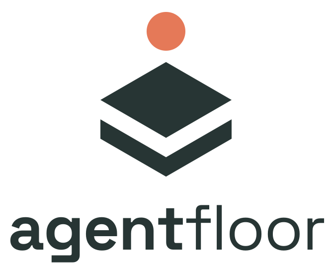

<p align="center">
  <picture>
    <source media="(prefers-color-scheme: dark)" srcset="brand/final/agent-floor-horizontal-reversed.svg">
    
  </picture>
</p>

# agent-floor-ui

**A living 3D office for your AI agents.** Watch your crew walk between desks, meetings, and the lab as they work. Hover a character to see its task. Plug it into any agent stack through a small, validated event API.

<p align="center">
  
</p>

<p align="center">
  React · TypeScript · Three.js · Vite &nbsp;|&nbsp; Template · Embeddable component · Mount plugin · VS Code and Claude skill
</p>



## Highlights

| | |
|---|---|
|  | **Hover any character** to see its role, status, current task, progress, location, and latest update. Click to pin the card; it follows the agent as it walks. |
|  | **Multiple floors.** Add up to 12 and switch with tabs. Customize the flooring, walls, accent colors, desk count, and rooms. Agents can move between floors. |
|  | **Themes and art styles.** Daylight, after-hours, and blueprint themes; soft 3D, voxel, and wireframe rendering. |
|  | **Characters with personality.** Hair styles, skin and hair tones, glasses, beards, headsets, and hoodies. They blink, walk, type, think, and shrug when blocked. |

<p align="center"></p>

## Run Locally

Requires Node.js 22.18+ and npm.

```sh
npm install
npm run dev
```

Open the URL Vite prints (usually http://127.0.0.1:5173). The initial crew is **simulated demo data**, not connected editor sessions. The UI never executes agents or automatically reads VS Code, Copilot, or Claude activity.

## Included

- An isometric office with six animated chibi-style characters: hair styles, skin and hair tones, glasses, beards, headsets, hoodies, blinking, walking, and status poses (typing, thinking, blocked shrug, idle).
- Hover a character to see its role, status, current task, progress, location, and latest activity; select it to pin the card.
- Multiple floors: add up to 12, switch with the floor tabs, and customize each floor's name, flooring (tile, oak, concrete, carpet), wall and accent colors, desk count, and rooms. Floors persist in the browser.
- Four agent destinations per floor: workstations, meeting room, lounge, and build lab.
- Daylight, after-hours, and blueprint themes; soft 3D, voxel, and wireframe art directions.
- Persistent appearance settings, label/shadow/animation switches, orbit, zoom, reset, and top view.
- Searchable/filterable crew, editable agent location, task details, status counts, and bounded activity feed.
- Responsive floor/crew/activity views and keyboard-accessible native dialogs.
- Validated event API, server-sent events, trusted-origin window messages, and a localhost HTTP relay.

The renderer uses procedural Three.js models, with no paid or externally downloaded art assets. Fonts use optional Google Fonts with local fallbacks.

## Installation Modes

The package is not published to npm yet. Create a local installable archive:

```sh
npm pack
```

### Component Or Mounting Plugin

In a host project:

```sh
npm install /absolute/path/to/agent-floor-ui-0.1.0.tgz
```

```tsx
import { AgentFloor, createFloorStore } from 'agent-floor-ui';
import 'agent-floor-ui/style.css';

const store = createFloorStore();

export function Factory() {
	return <AgentFloor store={store} demo={false} title="My AI Factory" />;
}

store.dispatch({
	type: 'agent.upsert',
	agent: {
		id: 'builder-1', name: 'Builder', role: 'Engineer', color: '#53b79b',
		status: 'working', task: 'Implementing the feature', zone: 'desks',
	},
});
```

The store must have a stable lifetime, outside the render function or created once with `useState`. A supplied store is fixed for the component's lifetime; remount to replace it. The browser-only component needs a client boundary in server-rendered frameworks. React 19+ is required.

For imperative mounting in another JavaScript UI (with a bundler):

```ts
import { mountAgentFloor } from 'agent-floor-ui';
import 'agent-floor-ui/style.css';

const floor = mountAgentFloor(document.getElementById('floor')!, { demo: false });
floor.dispatch({ type: 'activity', id: 'builder-1', message: 'Started tests' });
// On host teardown: floor.unmount();
```

This is an embeddable UI plugin, **not a packaged VS Code extension or Claude runtime plugin**. An editor webview can host the built app; the host must provide its own lifecycle adapter and webview CSP. That editor-specific wiring is not generated automatically.

### Copyable Template

```sh
npx --package /absolute/path/to/agent-floor-ui-0.1.0.tgz agent-floor-ui init ./my-agent-floor
cd my-agent-floor
npm install
npm run dev
```

The installer refuses nonempty destinations. It copies editable source, configuration, tests, and integration tooling.

### VS Code Or Claude Skill

From a source checkout:

```sh
node scripts/cli.mjs skill --target vscode --path /path/to/host-project
node scripts/cli.mjs skill --target claude --path /path/to/host-project
```

Or use the packed archive:

```sh
npx --package /absolute/path/to/agent-floor-ui-0.1.0.tgz agent-floor-ui skill --target claude --path /path/to/host-project
```

This installs `SKILL.md` and the event contract into `.github/skills/agent-floor-ui` or `.claude/skills/agent-floor-ui`. Existing skills are never overwritten. The skill guides integration with **real host callbacks**, not fabricated progress. Skill discovery depends on the host's supported skill settings.

## Connect Any Agent Stack

Any language can publish JSON to the local relay. Start it in a second terminal:

```sh
npm run build
npm run relay
```

In the UI choose **Connect a project** and use `http://127.0.0.1:4310/events`. Switching from demo clears the simulated crew and history.

Register an agent:

```sh
curl http://127.0.0.1:4310/events \
	-H 'Content-Type: application/json' \
	-d '{"type":"agent.upsert","agent":{"id":"builder-1","name":"Builder","role":"Engineer","color":"#53b79b","status":"working","task":"Implementing a feature","zone":"desks"}}'
```

Publish from the host's real hooks/callbacks:

```json
{ "type": "agent.move", "id": "builder-1", "zone": "lab" }
```
```json
{ "type": "activity", "id": "builder-1", "message": "Started the test suite" }
```
```json
{ "type": "agent.remove", "id": "builder-1" }
```

`agent.upsert` replaces a complete record. Statuses: `working`, `thinking`, `idle`, `blocked`. Zones: `desks`, `meeting`, `lounge`, `lab`. Text fields: 1-500 characters; colors: six-digit hex. Invalid events are rejected. Moving an unknown ID does nothing. Activity history is bounded to 60 entries.

Optional agent fields:

- `floor`: a floor ID (letters, digits, `-`, `_`). Unknown or missing floors show on the first floor. `agent.move` also accepts `floor`.
- `progress`: 0-100, shown as a progress bar in the hover card.
- `avatar`: `{ "skin": "#f2c6a0", "hair": "#2b2321", "hairStyle": "short|long|bun|cap|hood|spiky|bald", "accessory": "none|glasses|beard|glasses-beard|headset" }`. Omitted fields are derived consistently from the agent ID.

Floors are UI configuration. Pass initial floors with `<AgentFloor floors={[...]} />` (see `defaultFloors` and `createFloor`), or create them in the UI. Saved browser floors take precedence over the `floors` prop.

The relay is in-memory, replays current agent snapshots and recent activity to new viewers, and resets on restart. It binds **only to 127.0.0.1**, allows 100 agents and 32 viewers, and accepts a maximum event size of 64 KiB. It is not an authenticated public server. Do not expose it through a public tunnel or publish secrets in events. Default browser origins are localhost/127.0.0.1 on ports 5173 and 5174. For another frontend:

```sh
node scripts/cli.mjs relay --port 4310 --origin http://127.0.0.1:5180
```

For an existing SSE server, `connectEventSource(store, url, onStatus)` accepts ordinary JSON `data:` messages and returns a disconnect function. The endpoint must allow the frontend's origin. Cross-origin streams use no credentials; use a trusted backend adapter for authenticated providers.

For trusted browser hosts, `connectWindowMessages(store, exactOrigin, trustedWindow)` listens for `{ source: 'agent-floor-ui', event }` and returns a cleanup function. Both source window and exact origin are checked; wildcard origins are rejected.

## Development

```sh
npm test          # Event store and real HTTP/SSE relay tests
npm run build    # Standalone app + ESM library + TypeScript declarations
npm run test:ui  # Desktop/mobile browser, pixels, motion, and interaction checks
```

Regenerate the README screenshots and GIF while `npm run dev` is running:

```sh
npm run media                      # writes docs/media/*.png and GIF frames
pip install pillow                 # once, in any Python 3 environment
python3 scripts/make-gif.py        # assembles docs/media/demo.gif
```

The capture uses a fake browser clock, so every frame advances exactly 50 ms (20 fps) regardless of WebGL speed. Frames are captured at 2x and downsampled to a 960 px GIF with a shared 256-colour palette.

Browser tests use installed Google Chrome on Apple Silicon macOS. Other systems: `npx playwright install chromium` before running them. Screenshots are written to `test-results/`. The demo build lives in `dist-demo/`; the importable package lives in `dist/`. Three.js contributes most of the initial bundle size.

## Integration Boundary

Agent Floor is a visualization surface, not an orchestration engine. Connecting arbitrary agent factories is possible through the common event contract, but each factory needs an adapter to its actual lifecycle API. Installing the template or skill alone does not grant access to VS Code or Claude sessions.

## Brand

<p>
  
  &nbsp;
  
  &nbsp;
  
</p>

The **Floor Stack** mark is an agent (coral head) standing on stacked isometric floors. Colours: Agent Coral `#E57958` and Floor Ink `#273534`. Logo files are in [brand/final](brand/final); see the [logo guidelines](brand/GUIDELINES.md) for clear space, minimum sizes, and approved backgrounds.

## License

[MIT](LICENSE). The Space Grotesk font used in the wordmark is licensed under the [SIL Open Font License](brand/final/SpaceGrotesk-OFL.txt).